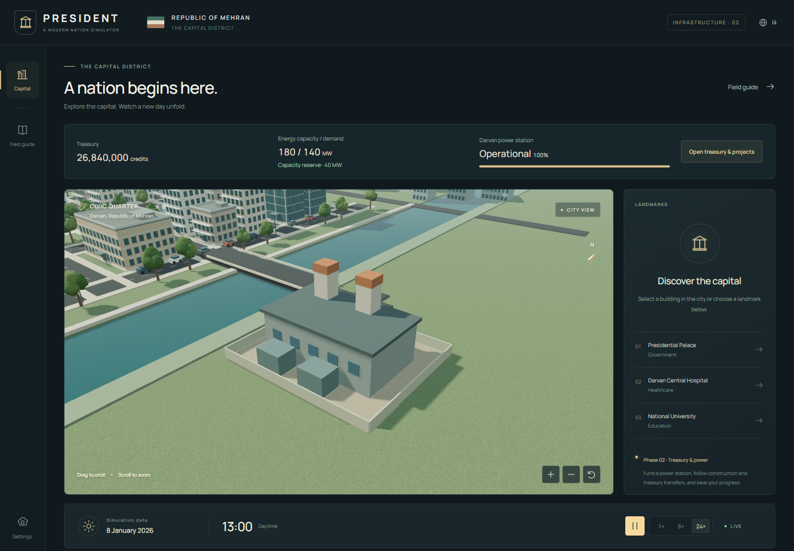

# PRESIDENT

**A modern nation & political strategy simulator · شبیه‌ساز حکمرانی و سیاست مدرن**

PRESIDENT is a browser strategy game about governing a fictional modern country. Development is incremental: the current **phase 02** adds a playable treasury → power construction → energy capacity loop, local save/resume, an interactive 3D capital and a bilingual interface. Further economic and political systems follow in separately approved phases.



## Run locally

Requires **Node.js 24**, npm, a modern WebGL2 browser and hardware acceleration. Rust is not required for this phase.

```powershell
npm ci
npm run dev -- --port 5173 --strictPort
```

Open `http://127.0.0.1:5173` after Vite reports that it is ready. This is a local address, not a published preview.

```powershell
npm run check                 # lint, typecheck, unit tests, production build
npx playwright install chromium
npm run test:e2e              # real Chromium interactions, software WebGL for CI
npm run build
npm run preview              # serve the production build locally
```

`npm run measure:render` starts a temporary server, measures with the default browser renderer, and closes its browser and server afterward. `node scripts/capture-preview.mjs --hardware` captures the actual UI with the same cleanup. Use `npm run measure:render -- --software` for explicitly software-rendered diagnostics; add `--plant` to measure the completed power station; on Windows, `npm run measure:render -- --hardware` requests D3D11 at a 1920×1080 viewport. Always check the recorded renderer rather than assuming hardware was used. Reports go under ignored `test-results/`; FPS is not a CI pass/fail gate.

## What works

- Fictional Darvan capital district: palace, offices, residences, hospital, university, plaza, gardens, river and bridge.
- Orbit, pan, zoom, reset, direct building selection and landmark focus; keyboard and touch alternatives.
- Paused start on **1 January 2026, 08:00**, 1/6/24 game hours per second, hidden-tab suspension and a matching day/night cycle.
- Persian RTL and English LTR throughout, including exact Persian/Gregorian date presentation, local numerals, guide, settings and building details. Language can change during play.
- Low/medium/high graphics, live renderer statistics, local fonts and no paid API requirement.
- Refined procedural materials, reflective glazing, balcony/roof details, clustered foliage, continuous surroundings and warm civic/street night lighting.
- Independent worker kernel and serializable contracts, with a documented path to profile-driven Rust/WASM acceleration.

- Treasury transfers, a funded 168-hour power station, visible construction, real capacity effects and one versioned IndexedDB save slot. Open **Treasury & infrastructure** above the city. [Scenario rules and save contract](docs/PHASE_02.md).

Automated tests own their temporary server and close it afterward. Do not run another server on port 5173 during `test:e2e`. Capture/measurement use port 5174. Close manually started `dev`/`preview`/watch sessions with Ctrl+C when finished.

## Current limits

The economy is a small closed-account scenario with fixed tax/service schedules and fixed power demand. There is no production, macroeconomics, cabinet, diplomacy, elections, national map/selection, population simulation or active traffic yet. Landmark categories are scene metadata. Reload starts a new session; explicitly restore the local save to continue. Saving overwrites one browser-local slot; restore starts paused, with no offline progress. Lighting changes by simulation hour and is not an astronomy model. Mobile UI is supported, but desktop browsers are the initial performance target. Browser software-renderer checks do not certify GPU performance. See the actual measurement report and known issues below.

## Structure and engineering

```text
src/engine/    # world/command/event contracts, clock, worker and tests
src/render/    # Three.js scene, instancing, selection and cleanup
src/ui/        # React shell, worker adapter, camera controls, guide/settings
src/data/      # fictional authored scenario geometry and metadata
src/i18n/      # English/Persian messages and date/number formatting
tests/        # Playwright interaction checks
docs/         # architecture, roadmap, test instructions, status and assets
```

The clock is the single authority. UI sends commands; the renderer consumes snapshots. JavaScript UTC arithmetic avoids host timezone drift. Repeated scene elements share geometry or use instancing. Vite produces static assets; React and Three.js run locally in the browser. Dependencies are locked in `package-lock.json`.

- [Architecture and Rust/WASM decision](docs/ARCHITECTURE.md)
- [Roadmap and phase approval policy](docs/ROADMAP.md)
- [Human test scenarios and bug reporting](docs/MANUAL_TEST.md)
- [Current development status](docs/DEVELOPMENT_STATUS.md)
- [Measured performance and limitations](docs/PERFORMANCE.md)
- [Asset sources and licensing](docs/ASSETS.md)
- [Original Persian product brief](docs/PRODUCT_BRIEF.fa.md)

GitHub Actions checks pull requests and main pushes, runs Chromium checks and uploads production assets and a browser report. Phase branches are checked through their PRs to avoid duplicate push/PR runs. A successful artifact upload is not an online deployment. Each phase has its own branch and PR. **The owner has authorized merging completed phases after successful latest-head checks. Starting each new phase still requires separate explicit owner approval.** This 2026-10-19 instruction supersedes the original per-merge confirmation rule in the historical product brief.

## راه‌اندازی و بررسی فارسی

پس از نصب Node.js 24، در پوشهٔ پروژه `npm ci` و سپس `npm run dev -- --port 5173 --strictPort` را اجرا کنید. بازی به‌صورت پیش‌فرض فارسی و متوقف شروع می‌شود. دوربین را حرکت دهید، بناهای شاخص را انتخاب کنید و با ادامهٔ زمان و سرعت ۲۴× چرخهٔ روز و شب را ببینید. تغییر زبان از بالای صفحه و تنظیم کیفیت از تنظیمات در دسترس است.

فاز دوم شامل خزانه، تراکنش‌های واقعی میان حساب‌ها، ساخت نیروگاه هفت‌روزه و ذخیرهٔ محلی است. از «نمایش خزانه و پروژه‌ها» پروژه را تأمین مالی کنید، زمان را ادامه دهید و افزایش ظرفیت از ۱۰۰ به ۱۸۰ مگاوات را پس از تکمیل ببینید. ذخیره و بازیابی در همان بخش است؛ بارگذاری مجدد نشست تازه می‌سازد و برای ادامه باید ذخیره را بازیابی کنید. سرورهای موقت تست و اندازه‌گیری خودکار بسته می‌شوند؛ اجرای دستی را با Ctrl+C ببندید. اقتصاد کلان و سیاست هنوز در فازهای آینده هستند. طبق دستور جدید صاحب پروژه، پس از موفقیت بررسی‌های آخرین کامیت، فاز تکمیل‌شده Merge می‌شود؛ شروع فاز بعد همچنان مجوز جداگانه می‌خواهد. تأیید تست انسانی فقط براساس بازخورد واقعی ثبت می‌شود. اشکال‌ها را همراه مراحل بازتولید، مرورگر، تنظیم کیفیت، اندازهٔ صفحه و تصویر در PR یا گفتگو گزارش کنید.

No project-wide license has been selected by the owner. Bundled third-party licenses are preserved in `public/THIRD_PARTY_NOTICES.txt`.
